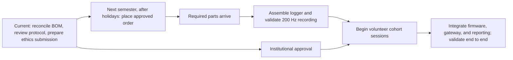
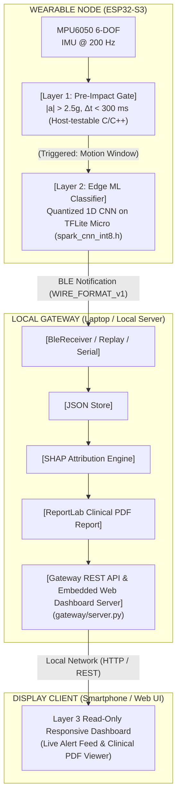
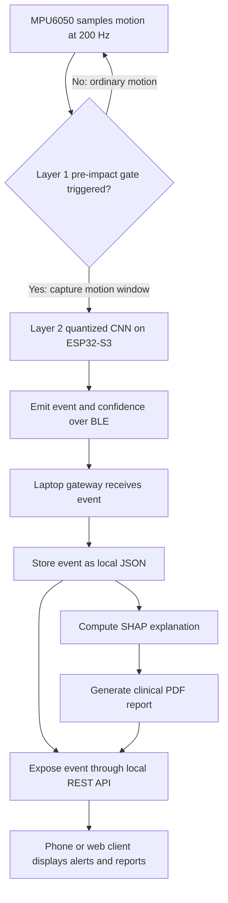

# SPARK — Signal Pattern Analysis & Real-time Kinetics

> **A Two-Layer Gated Edge-AI Fall Detection & Kinetic Pattern Recognition System with Explainable Telemetry**  
> Major Project (8th Semester) — Department of Electronics & Computer Engineering, Kathmandu Engineering College (KEC), Institute of Engineering (IOE), Tribhuvan University, Nepal.  
> *Human fall detection is the primary completion objective. Offline SisFall results are available; physical wrist-worn and cohort evaluation remain pending. Robot fall monitoring is an open research extension.*

---

##  Project Team & Supervision

| Role | Name | Primary Focus |
| :--- | :--- | :--- |
| **Project Lead** | **Aaradhya Dev Tamrakar** | Gateway Pipeline, SHAP Explainability & ML Modeling |
| **Firmware Engineer** | **Rupesh Kadel** | ESP32-S3 ESP-IDF Firmware, Layer 1 Gate & TFLite Micro |
| **Hardware Engineer** | **Sankalpa Lamsal** | 3D TPU Enclosure Design, Sensor Integration & Power |
| **Gateway / UI Engineer** | **Sonia Thapa** | Gateway Receiver, Clinical PDF Report & Web Dashboard |
| **Project Supervisor** | **Er. Dipen Manandhar** | Academic & Technical Supervision |

---

##  Project Progress & Roadmap

> [!NOTE]
> Procurement is expected to begin next semester, after the Dashain, Tihar, and Chhath holidays. The current phase is pre-procurement readiness: reconcile the order package and finish protocol and ethics preparation. Hardware bring-up follows parts arrival; volunteer recording requires logger validation and institutional approval. See the [resumption plan](docs/SPARK_POST_BOARDS_MASTER_PLAN.md).

### Delivery Milestones

| Phase | GitHub milestone | Status and exit condition |
| :--- | :--- | :--- |
| Pre-procurement readiness | [Pre-Procurement Readiness](https://github.com/Aaradhya-Dev-Tamrakar/SPARK/milestone/1) | **Current.** Complete BOM review, protocol activity mapping, and ethics preparation before ordering. |
| Procurement and hardware bring-up | [Hardware Bring-Up](https://github.com/Aaradhya-Dev-Tamrakar/SPARK/milestone/2) | **Queued.** Procurement starts next semester after the holidays; assemble and validate the logger after parts arrive. |
| Integration and validation | [System Integration and Validation](https://github.com/Aaradhya-Dev-Tamrakar/SPARK/milestone/3) | **Later.** Complete dependent gateway, explainability, model-reporting, and integrated validation work. |

Milestones have no due dates until the next-semester ordering and delivery windows are confirmed.

### Thesis reports

The [report index](docs/THESIS_REPORTS.md) links the independent [mid-defense progress report](docs/SPARK_Mid_Defense/main.pdf) and [final-defense thesis draft](docs/SPARK_Final_Defense/main.pdf), their editable sources, evidence snapshots, and build instructions. The [proposal](docs/SPARK_Proposal/ThesisReports/thesis_report.tex) remains preserved.

### Next-Semester Execution Gates



Volunteer sessions wait for both logger validation and institutional approval. Calendar dates will be added after the ordering and delivery windows are confirmed.

### Workstream Status

| Module / workstream | Assignee | Status | Current deliverable or next condition |
| :--- | :--- | :--- | :--- |
| **ML Modeling & Quantization** | Aaradhya Dev Tamrakar | **Offline artifacts available; review pending** | August and October model generations have separate results. October threshold provenance and deployed model identity require reconciliation; on-device evaluation remains pending. |
| **Gateway & Explainability** | Aaradhya Dev Tamrakar | **Software implemented; integration pending** | Parser, storage, reporting, and REST modules exist. Waveform gradient attribution is distinct from exact SHAP; v1 events support peak-feature fallback. Physical BLE validation remains. |
| **Protocol & Procurement Preparation** | Aaradhya Dev Tamrakar | **In progress** | Protocol draft and order form exist; activity review, ethics preparation, and order readiness remain. |
| **Deep-Research Synthesis** | Aaradhya Dev Tamrakar | **Complete** | Research synthesis and documented architecture decisions are available in the research board. |
| **Physical ESP32-S3 Firmware** | Rupesh Kadel | **Hardware pending** | Host-testable components exist; physical I2C, BLE, and on-device validation follow board receipt. |
| **Enclosure CAD & 3D Printing** | Sankalpa Lamsal | **Not started** | Parametric model and slicer profile remain; proceed when required parts and interface dimensions are available. |
| **Layer 3 Mobile Display Client** | Sonia Thapa | **Not started** | Gateway API exists; display client implementation and integration remain. |
| **Nepal Cohort Trials** | Team (KEC Cohort) | **Not started** | Begin only after institutional approval and logger validation. |

---

##  System Architecture



### Detection Event Flow



The phone and web client are display-only. BLE reception, event storage, explainability, and PDF generation run on the gateway.

---

##  Branching & Workstreams

| Branch | Lead / Assignee | Workstream Scope | Status |
| :--- | :--- | :--- | :---: |
| `main` | Team | Production stable, integrated deliverables & LaTeX reports | **STABLE**  |
| `feat/firmware-layer1` | `@RupeshKadel` | ESP32-S3 physical firmware, MPU6050 I2C driver & on-device TFLite Micro | **NOT STARTED / 0%**  |
| `feat/enclosure-cad` | `@SankalpaLamsal` | Parametric 3D CAD modeling, TPU 95A slicer tuning & physical print | **NOT STARTED / 0%**  |
| `feat/gateway-dashboard` | `@SoniaThapa` | Mobile display client UI & live gateway frontend | **NOT STARTED / 0%**  |
| `feat/training-pipeline` | `@AaradhyaDT` | SisFall raw ingestion, CNN architecture, and TFLite model quantizer | **MERGED**  |
| `feat/gateway-shap` | `@AaradhyaDT` | BLE receiver, wire format parser, SHAP feature attribution & PDF report | **MERGED**  |

---

---

##  Active Development Tracking & Remaining Works

###  Completed Work
- [x] **Proposal Defense**: Successfully defended mid-term proposal (Passed July 9, 2026).
- [x] **BOM & Procurement Lock**: Component order form finalized (`docs/SPARK_Component_Order_Form.xlsx`, Daraz/Himalayan Solution/Giga Nepal).
- [x] **Electrical Safety & Charging Architecture**: Dual single-purpose USB-C ports locked (Action #38, off-body charging only).
- [x] **Two-Layer ML Pipeline**: 1D CNN trained on SisFall with subject-grouped isolation ($0.9185$ AUC-ROC, $87.81\%$ sensitivity) and quantized to $18.5\text{ KB}$ INT8 (`spark_cnn_int8.tflite`).
- [x] **Firmware Model Embedding**: INT8 model byte array generated and wired into `firmware/main/models/spark_cnn_int8.h`.
- [x] **Gateway & Explainability**: BLE GATT client (`BleReceiver`), diverse clinical SHAP explainer, automated ReportLab PDF generator, and local REST API (`gateway/server.py`) delivered.
- [x] **Gateway Hardware Acceleration**: Intel Core Ultra 7 155H NPU and Arc iGPU benchmarked via OpenVINO (Action #27 resolved).
- [x] **Nepal Cohort Protocol**: 34-activity standardized trial protocol drafted (`docs/DATA_COLLECTION_PROTOCOL.md`, Action #23).

### ⏳ Remaining Works to Final Deployment
- [ ] **Physical Hardware Delivery & Bench Verification (Action #16 / #18)**: Receive departmental ESP32-S3 N16R8 boards, MPU6050 breakout, 1100mAh LiPo cells, and TP4056 modules for electrical bring-up.
- [ ] **Parametric 3D CAD & Slicing (Action #17)**: Finalize two-zone dorsal wrist bracer in CAD (`.step`/`.stl`), verify M2.5 screw boss wall thicknesses, and tune TPU 95A 3D print profile.
- [ ] **Nepal Cohort Data Collection Execution (Issue #6)**: Execute controlled crash-mat fall simulations and ADL recordings at KEC to fine-tune the CNN on real dorsal-wrist kinematics.
- [ ] **On-Hardware BLE & Layer 1 Validation**: Flash firmware to physical ESP32-S3, verify real-time Layer 1 threshold triggering on wrist motion, and validate end-to-end BLE event reception.
- [ ] **Layer 3 Mobile Display Client Integration (Issue #5)**: Connect mobile web dashboard to gateway REST endpoints (`GET /api/events`).
- [ ] **Thesis Draft & Defense Prep (Action #26)**: Narrow Novelty Claims 1 & 3 against recent 2024–2025 literature and finalize LaTeX thesis report (`thesis_report.tex`).

---

##  Repository Directory Layout

```
SPARK/
├── .github/                      # GitHub workflows and PR templates
│   └── pull_request_template.md  # Standard pull request checklist
├── .pre-commit-config.yaml       # Pre-commit hooks (Ruff linter, formatter, file guards)
├── pyproject.toml                # PEP 517/621 package specification, Ruff & pytest configs
├── LICENSE                       # MIT License
├── AGENT.md                      # Universal AI agent & developer guidelines
├── AGENTS.md                     # Quick agent guidelines & command index
├── CLAUDE.md                     # Claude developer instructions
├── ANTIGRAVITY.md                # Google Antigravity & Gemini instructions
├── sync.ps1                      # Local git workflow: auto-stage, commit, rebase-pull, push
├── README.md                     # Master project documentation
│
├── firmware/                     # ESP-IDF C/C++ Firmware (Wearable Node)
│   ├── CMakeLists.txt            # ESP-IDF build configuration
│   ├── sdkconfig.defaults        # ESP32-S3 default hardware configuration
│   ├── main/                     # Application entry, sensor drivers, Layer 1 filter
│   │   └── models/               # Flash-resident INT8 model array (spark_cnn_int8.h)
│   └── test/                     # Host-executable unit tests (21/21 passed)
│
├── training/                     # Machine Learning & Data Pipelines
│   ├── data_prep/                # Dataset ingestion scripts (prepare_sisfall.py)
│   ├── notebooks/                # ML exploration & classical baselines (RF / XGBoost)
│   ├── train_cnn.py              # Primary 1D CNN training pipeline ($0.9185$ AUC-ROC)
│   ├── quantize_model.py         # INT8 post-training quantizer & C header exporter
│   └── requirements.txt          # ML training Python dependencies
│
├── gateway/                      # Local Gateway & Explainability Pipeline
│   ├── main.py                   # Gateway service entry point (BLE, Replay, Serial)
│   ├── server.py                 # Local REST API & Web Dashboard server
│   ├── receiver/                 # BleReceiver (bleak), ReplayReceiver, SerialReceiver
│   ├── shap_pipeline/            # CnnShapExplainer & PeakFeatureExplainer
│   ├── report/                   # ReportLab clinical PDF generator
│   └── storage/                  # JsonEventStore local JSON record archiving
│
├── tests/                        # Repository Python Test Suite (48/48 Passing)
│   ├── test_ble_receiver.py
│   ├── test_gateway_pipeline.py
│   ├── test_gateway_server.py
│   ├── test_json_store.py
│   ├── test_pdf_report.py
│   ├── test_quantize_model.py
│   ├── test_shap_pipeline.py
│   ├── test_train_cnn.py
│   └── test_wire_format.py
│
├── data/                         # Datasets & Trial Recordings (Gitignored)
│   ├── README.md                 # SisFall setup & Nepal trial dataset instructions
│   └── .gitkeep
│
├── docs/                         # Specifications & Academic Reports
│   ├── CHANGELOG.md              # Project change log (v55)
│   ├── DATA_COLLECTION_PROTOCOL.md # Nepal cohort human-subject trial protocol
│   ├── WIRE_FORMAT_v1.md         # Locked BLE event protocol schema
│   ├── SPARK_POST_BOARDS_MASTER_PLAN.md # Post-boards resumption roadmap & context archive
│   ├── SPARK_research_board_merged.md   # 19-track deep-research evidence base
│   ├── SPARK_Component_Order_Form.xlsx # Canonical hardware BOM procurement spreadsheet
│   ├── SPARK_Presentation_Mid_Term_Defense_v6.pptx # Mid-term defense slide deck
│   └── SPARK_Proposal/           # Complete LaTeX thesis proposal source
│       └── ThesisReports/        # LaTeX report (thesis_report.tex, compiling to PDF)
│
└── dev_logs/                     # Engineering Journals & Design Assets
    ├── SPARK_TRACKER.md          # Single source of truth master project tracker (v55)
    └── design-assets/            # 3D CAD references, master design sheet (v2), and walkthroughs
```

---

##  Development & Tooling

This project uses [`uv`](https://github.com/astral-sh/uv) for fast, deterministic Python environment management and linting.

### Python Environment & Tests
```bash
# Run unit test suite
uv run pytest

# Check code with Ruff linter
uv run ruff check --fix

# Format code with Ruff formatter
uv run ruff format
```

### Firmware Host Unit Tests & Flashing (ESP-IDF)
```bash
# Run host-based firmware unit tests
cd firmware/test
# Compile and execute host test runner

# Build and flash to ESP32-S3 target
cd firmware
idf.py set-target esp32s3
idf.py build
idf.py -p COM_PORT flash monitor
```

### Building Academic LaTeX Report
```bash
cd docs/SPARK_Proposal/ThesisReports
latexmk -pdf thesis_report.tex
```
*Note: Build artifacts (`.aux`, `.log`, `.toc`, etc.) are gitignored; only [`thesis_report.pdf`](docs/SPARK_Proposal/ThesisReports/thesis_report.pdf) is tracked.*

---

##  Local Git Workflow (`sync.ps1`)

To maintain clean conventional commits and keep `SPARK_TRACKER.md` synchronized, use the provided PowerShell sync script:

```powershell
# Automatically stage, generate smart commit message, pull --rebase, and push
.\sync.ps1

# Sync with a custom conventional commit message
.\sync.ps1 -m "feat(training): optimize CNN hyperparameters"

# Build thesis_report.tex PDF first, then sync
.\sync.ps1 -Build

# Pull only (with autostash) without committing
.\sync.ps1 -PullOnly
```

---

##  License

This project is licensed under the MIT License — see the [`LICENSE`](LICENSE) file for details.
