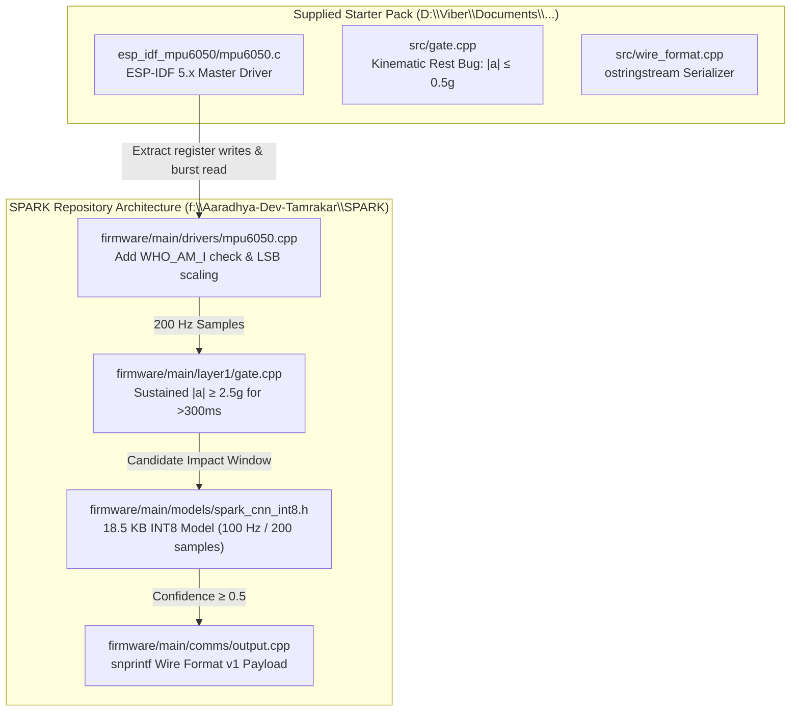
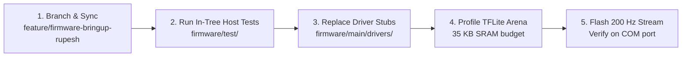

# Technical Evaluation and Integration Specification: `RUPESH_SPARK_FIRMWARE_STARTER`

**Assignee:** Rupesh Kadel (Roll 79034 / BEI — Firmware Engineer)  
**Author:** Aaradhya Dev Tamrakar (Project Lead)  
**Date:** October 20, 2026  
**Target:** ESP32-S3 WROOM-1 / MPU6050 Firmware Subsystem (`firmware/`)  
**Status:** Engineering Review & Module Integration Contract (`E2` Bench Prototype)

---

## 1. Executive Evaluation

Rupesh submitted a standalone firmware pack (`RUPESH_SPARK_FIRMWARE_STARTER`) implementing an ESP-IDF 5.x MPU6050 I2C driver, a threshold gate, a JSON serializer, and 21 host test cases. The driver correctly configures the MPU6050 registers for 200 Hz sampling and adopts the modern ESP-IDF 5.x I2C master driver API. However, the Layer 1 state machine introduces a kinematic failure mode by requiring post-impact acceleration magnitude $|a| \le 0.5g$, which is physically impossible for a stationary body on Earth. 

This document defines the physical correction, specifies the integration of the register driver into `firmware/main/drivers/mpu6050.cpp`, and outlines the remaining tasks required to close Issue #11 (Firmware Compilation & Static Memory Audit) and Issue #1 (Layer 1 Gate & On-Chip Inference).



---

## 2. Component Audits

### 2.1 MPU6050 Driver (`esp_idf_mpu6050/mpu6050.c`, `mpu6050.h`)

#### Implemented State
The driver uses the ESP-IDF 5.x `driver/i2c_master.h` API with 7-bit addressing at 400 kHz (`scl_speed_hz = 400000`). It establishes the following register configuration during `mpu6050_init`:

| Register | Address | Configured Value | Operational Mode |
| :--- | :--- | :--- | :--- |
| `PWR_MGMT_1` | `0x6B` | `0x01` | Wake device, clock source = PLL with X-axis gyro reference. |
| `CONFIG` | `0x1A` | `0x03` | DLPF: 44 Hz accelerometer bandwidth, 42 Hz gyroscope bandwidth, 4.9 ms delay. |
| `SMPLRT_DIV` | `0x19` | `0x04` | $F_{\text{sample}} = \frac{1000\text{ Hz}}{1 + 4} = 200\text{ Hz}$. |
| `GYRO_CONFIG` | `0x1B` | `0x08` | Full-scale $\pm 500^\circ/\text{s}$, sensitivity factor $65.5\text{ LSB}/(^\circ/\text{s})$. |
| `ACCEL_CONFIG` | `0x1C` | `0x10` | Full-scale $\pm 8g$, sensitivity factor $4096\text{ LSB}/g$. |
| `ACCEL_XOUT_H` | `0x3B` | Read 14 bytes | Single-transaction burst read: Accel (6B) + Temp (2B) + Gyro (6B). |

#### Required Modifications Prior to In-Tree Adoption
1. **Device Identification Guard**: Register `0x75` (`WHO_AM_I`) must be polled before writing configuration registers. If the returned byte is not `0x68`, return `ESP_ERR_NOT_FOUND` to surface loose I2C wiring immediately.
2. **Handle Lifecycle**: On configuration failure during init, the allocated `i2c_master_dev_handle_t` must be removed via `i2c_master_bus_rm_device` to prevent resource leaks across bus restarts.
3. **LSB to Physical Units**: Raw `int16_t` values must be cast and scaled to standard SI/engineering units ($g$ and $^\circ/\text{s}$) prior to ingestion by Layer 1:
   $$a_{\text{axis}} = \frac{\text{raw\_lsb}}{4096.0\text{f}} \quad [g], \qquad \omega_{\text{axis}} = \frac{\text{raw\_lsb}}{65.5\text{f}} \quad [^\circ/\text{s}]$$

---

### 2.2 Layer 1 Gate Kinematics (`src/gate.cpp`, `include/spark/gate.h`)

#### The Proper Acceleration Invariant
MEMS accelerometers measure proper acceleration (specific force), not coordinate acceleration. At stationary rest on Earth, the sensor experiences an upward normal force of $1.0g$ ($9.81\text{ m/s}^2$) balancing gravity:

$$\|a\| = \sqrt{a_x^2 + a_y^2 + a_z^2} \approx 1.0g$$

#### The Kinematic Failure Mode in `src/gate.cpp`
The supplied starter gate implements the following logic:
```cpp
// src/gate.cpp, lines 36-44
if (last_magnitude_g_ <= config_.rest_threshold_g) { // config_.rest_threshold_g = 0.5f
    if (!rest_timer_started_) {
        rest_timer_started_ = true;
        rest_start_ms_ = timestamp_ms;
    }
    if (timestamp_ms - rest_start_ms_ >= config_.rest_duration_ms) {
        state_ = GateState::ConfirmedCandidate;
        return true;
    }
}
```

* **Physical consequence**: After an impact, a subject lying motionless on a floor or crash mat registers an acceleration vector of magnitude $\|a\| \approx 1.0g$. Because $1.0g > 0.5g$, the condition `last_magnitude_g_ <= 0.5f` is never satisfied. The timer never increments, and the state machine resets after `candidate_timeout_ms` (3,000 ms), discarding the true fall event.
* **Test suite discrepancy**: In `tests/test_main.cpp` (Line 30), feeding `sample(0, 0, 1.0f)` is explicitly evaluated as *"motion interrupts rest timer"*. This codifies a physical error into the test suite:

```cpp
// tests/test_main.cpp, line 30
{"motion interrupts rest timer", [] {
    Layer1Gate g;
    g.update(sample(0,0,2.6f),10);
    g.update(sample(0,0,0.2f),20);
    g.update(sample(0,0,1.0f),150); // Evaluating 1.0g (static stillness) as motion
    return !g.update(sample(0,0,0.2f),320);
}}
```

#### Grounding to the SPARK Architecture Spec
In SPARK's locked proposal specification ([`firmware/main/layer1/gate.h`](file:///f:/Aaradhya-Dev-Tamrakar/SPARK/firmware/main/layer1/gate.h)):
1. Layer 1 operates as a low-power wake-up filter. Its sole responsibility is detecting sustained kinematic impact ($\|a\| \ge 2.5g$ for $\Delta t > 300\text{ ms}$).
2. Post-impact rest is evaluated by the Layer 2 INT8 CNN across a 2-second, 200-sample temporal window containing pre-fall, impact, and post-fall kinetics. The scalar gate must not attempt to classify post-impact rest with an uncalibrated low-pass magnitude threshold.

---

### 2.3 Wire Format Serialization (`src/wire_format.cpp`)

#### Schema Compliance
The output format matches [`docs/WIRE_FORMAT_v1.md`](file:///f:/Aaradhya-Dev-Tamrakar/SPARK/docs/WIRE_FORMAT_v1.md):
```json
{
  "event_id": "EVT-1001",
  "device_id": "SPARK-NODE-01",
  "firmware_version": "1.0.0",
  "timestamp_ms": 128540,
  "confidence": 0.892,
  "peak_features": {
    "a_x": 0.420, "a_y": 2.810, "a_z": 1.150,
    "w_x": 120.400, "w_y": 340.200, "w_z": 45.100
  }
}
```

#### MCU Runtime Constraint: Dynamic Allocation vs. Fixed Buffers
* **Issue**: `std::ostringstream` and dynamic `std::string` concatenation incur heap allocations (`malloc`/`free`) and link standard library format streams, introducing ~120 KB of flash overhead on Xtensa LX7 targets.
* **Prescribed Pattern**: SPARK firmware uses bounded stack buffers with `snprintf` as implemented in [`firmware/main/comms/output.cpp`](file:///f:/Aaradhya-Dev-Tamrakar/SPARK/firmware/main/comms/output.cpp). The wire payload is fixed at $< 384\text{ bytes}$, well within the ESP32-S3 FreeRTOS task stack budget.

---

## 3. Integration Specification: Porting Driver into `firmware/`

Rupesh's driver functions will be ported directly to replace the stub bodies in [`firmware/main/drivers/mpu6050.cpp`](file:///f:/Aaradhya-Dev-Tamrakar/SPARK/firmware/main/drivers/mpu6050.cpp).

### 3.1 Class Binding Interface

```cpp
// firmware/main/drivers/mpu6050.h
#pragma once
#include <cstdint>
#include "esp_err.h"
#include "driver/i2c_master.h"

namespace spark::drivers {

struct Mpu6050Sample {
    float accel_x_g;
    float accel_y_g;
    float accel_z_g;
    float gyro_x_dps;
    float gyro_y_dps;
    float gyro_z_dps;
    uint32_t timestamp_us;
};

class Mpu6050Driver {
public:
    Mpu6050Driver() = default;
    esp_err_t Init(i2c_master_bus_handle_t bus_handle, uint8_t dev_addr = 0x68);
    esp_err_t ReadSample(Mpu6050Sample* out_sample);
    bool IsInitialized() const { return initialized_; }

private:
    i2c_master_dev_handle_t dev_handle_ = nullptr;
    bool initialized_ = false;
};

} // namespace spark::drivers
```

### 3.2 Conversion Implementation
In `firmware/main/drivers/mpu6050.cpp`, translate the raw 14-byte burst read using big-endian signed 16-bit integer reconstruction, then scale by the selected full-scale divisors:

```cpp
esp_err_t Mpu6050Driver::ReadSample(Mpu6050Sample* out_sample) {
    if (!initialized_ || !out_sample) return ESP_ERR_INVALID_STATE;

    uint8_t buffer[14];
    uint8_t reg = 0x3B; // REG_DATA
    esp_err_t err = i2c_master_transmit_receive(dev_handle_, &reg, 1, buffer, sizeof(buffer), 100);
    if (err != ESP_OK) return err;

    auto be16 = [](const uint8_t* p) -> int16_t {
        return static_cast<int16_t>((static_cast<uint16_t>(p[0]) << 8) | p[1]);
    };

    // AFS_SEL = 2 (±8g) -> 4096 LSB/g
    // FS_SEL = 1 (±500 dps) -> 65.5 LSB/dps
    out_sample->accel_x_g   = be16(&buffer[0])  / 4096.0f;
    out_sample->accel_y_g   = be16(&buffer[2])  / 4096.0f;
    out_sample->accel_z_g   = be16(&buffer[4])  / 4096.0f;
    out_sample->gyro_x_dps  = be16(&buffer[8])  / 65.5f;
    out_sample->gyro_y_dps  = be16(&buffer[10]) / 65.5f;
    out_sample->gyro_z_dps  = be16(&buffer[12]) / 65.5f;
    out_sample->timestamp_us = static_cast<uint32_t>(esp_timer_get_time());

    return ESP_OK;
}
```

---

## 4. Execution Sequence for Rupesh

To integrate this work with the repository and verify the physical hardware upon arrival, Rupesh must complete the following steps:



### Step 1: Branch Off Canonical Repository
Clone the authoritative repository and isolate firmware development:
```bash
git clone https://github.com/Aaradhya-Dev-Tamrakar/SPARK.git
cd SPARK
git checkout -b feature/firmware-bringup-rupesh
```

### Step 2: Execute Canonical In-Tree Unit Tests
Run the existing host-executable test suite verifying Layer 1 gate timing and wire format serialization:
```bash
cd firmware/test
g++ -std=c++17 -I../main test_gate.cpp ../main/layer1/gate.cpp -o test_gate
./test_gate

g++ -std=c++17 -I../main test_wire_format.cpp ../main/comms/output.cpp ../main/comms/peak_features.cpp -o test_wire_format
./test_wire_format
```
**Acceptance Criterion:** 0 test failures across both suites.

### Step 3: Implement Driver Binding
Copy the verified register initialization logic from `esp_idf_mpu6050/mpu6050.c` into [`firmware/main/drivers/mpu6050.cpp`](file:///f:/Aaradhya-Dev-Tamrakar/SPARK/firmware/main/drivers/mpu6050.cpp), adding the `WHO_AM_I` check and LSB scaling specified in Section 3.

### Step 4: Profile INT8 TFLite Micro Model in SRAM (Task 3 in Guide)
Inspect [`firmware/main/models/spark_cnn_int8.h`](file:///f:/Aaradhya-Dev-Tamrakar/SPARK/firmware/main/models/spark_cnn_int8.h) ($18.5\text{ KB}$ INT8 array). In `firmware/main/tflite/inference.cpp`:
1. Allocate the static tensor arena:
   ```cpp
   constexpr int kTensorArenaSize = 35 * 1024;
   static uint8_t tensor_arena[kTensorArenaSize];
   ```
2. Initialize `tflite::MicroInterpreter` and execute `AllocateTensors()`.
3. Log peak arena consumption over serial (`arena_used_bytes()`).
**Acceptance Criterion:** Total allocated tensor arena footprint $\le 35\text{ KB}$ of SRAM with zero heap allocation.

### Step 5: Verify 200 Hz Serial Streaming (Task 6 in Guide)
Build and flash `firmware/` with `SPARK_MODE_DATA_LOGGER`:
```bash
idf.py set-target esp32s3
idf.py build
idf.py -p COMx flash monitor
```
Pipe the output to [`tools/record_cohort_data.py`](file:///f:/Aaradhya-Dev-Tamrakar/SPARK/tools/record_cohort_data.py) and confirm that sample intervals remain stable at $5000\pm 200\,\mu\text{s}$ ($200\text{ Hz}$) with zero dropped samples over a 60-second window.

---

## 5. Technical Decision Log

| Component | Decision | Rationale |
| :--- | :--- | :--- |
| **I2C Driver** | Adopt Rupesh's `driver/i2c_master.h` implementation. | Avoids deprecated legacy v4 driver; registers are verified for 200 Hz / $\pm 8g$ / $\pm 500^\circ/\text{s}$. |
| **Layer 1 Gate** | Reject scalar rest check ($|a| \le 0.5g$); retain sustained impact gate ($\ge 2.5g$, $>300\text{ ms}$). | Proper acceleration at rest on Earth is $1.0g$. Post-fall inactivity classification is delegated to Layer 2 INT8 CNN across the 2-second window. |
| **JSON Output** | Retain stack `snprintf` in `comms/output.cpp`. | Eliminates `<sstream>` C++ runtime flash overhead (~120 KB) and heap fragmentation on FreeRTOS. |
| **Model Arena** | 35 KB static tensor arena in internal SRAM. | Accommodates 18.5 KB INT8 model weights and intermediate feature maps with 0 dynamic heap allocations. |
