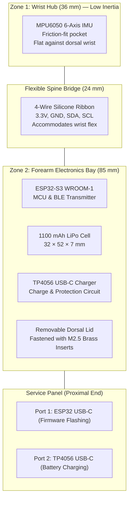

# SPARK — Sankalpa's Quick Start Guide

**For:** Sankalpa Lamsal (79039 / BEI — Hardware & CAD Engineer)  
**Created:** October 20, 2026  
**Purpose:** One-stop onboarding document. Read this first to understand your ownership of mechanical CAD, enclosure fabrication, power wiring, and physical assembly.

---

## 1. What is SPARK & What is Your Mission?

**SPARK** (*Signal Pattern Analysis & Real-time Kinetics*) is an AI-powered fall detection and kinetic distress alerting wearable for the elderly.

While the software team writes firmware and ML models, **your mission is to bring the physical wearable to life**:
- Design the ergonomic, flexible 3D-printed enclosure.
- Fit all 4 electronic modules into a wearable two-zone form factor.
- Guarantee user electrical safety (off-body charging).
- Ensure the device survives high-impact falls without shattering or bruising the user.



---

## 2. Why the Two-Zone 270° C-Shell Architecture?

Older wearable concepts put everything into a bulky watch on the wrist. In SPARK, **we deliberately rejected that**:

1. **Biomechanical Stability**: Putting a heavy $25\text{g}$ battery and MCU directly on the wrist creates rotational inertia and whip when the arm moves, generating false fall alerts. Moving the heavy parts to the **forearm (Zone 2)** keeps the **wrist (Zone 1)** ultra-light ($<2\text{g}$ IMU only).
2. **270° Semi-Rigid C-Clamp**: The enclosure wraps $75\%$ around the forearm and wrist, leaving a $90^\circ$ ventral gap closed by an elastic Velcro strap over a compression sleeve. This supports easy one-handed daily self-application for elderly users with limited grip strength.
3. **Material Choice (TPU 95A)**: Standard 3D plastics (PLA/ABS) are brittle and crack upon ground impact. TPU 95A is a flexible, impact-absorbing polyurethane available directly at the **KEC Makerspace**.

---

## 3. The Team & Your Role

| Person | Role | What They Own |
| :-- | :-- | :-- |
| **Aaradhya Dev Tamrakar** | Project Lead | ML model training, gateway SHAP explainability, clinical PDF reports, overall architecture |
| **Rupesh Kadel** | Firmware Engineer | ESP32-S3 firmware, MPU6050 sensor driver, Layer 1 gate, TFLite Micro inference, BLE |
| **Sankalpa Lamsal (You)** | Hardware & CAD Engineer | **Mechanical CAD (Fusion 360), 3D printing (TPU 95A), M2.5 brass heat-set inserts, wiring harness & physical assembly** |
| **Sonia Thapa** | Display Client | Mobile/web dashboard, volunteer consent forms, clinical testing logistics |

---

## 4. Repository Map — Where Your Assets Live

```
SPARK/
├── dev_logs/design-assets/          ◄◄◄ YOUR PRIMARY DIRECTORY ◄◄◄
│   ├── SPARK_270deg_C_Shell_Design_DI03.md  ← Canonical CAD dimension reference (READ THIS FIRST)
│   ├── CAD_SOFTWARE_GUIDE.md                ← Fusion 360 setup, licenses, and learning path
│   ├── CAD_PRACTICE_PART_WALKTHROUGH.md     ← Step-by-step tutorial to build your first part
│   ├── DESIGN_IDEAS.md                      ← Concept sketches and exploration log
│   ├── enclosure_concept_v1_two_zone_bracer.png
│   ├── enclosure_concept_v2_gemini_270deg.jpg ← Assembly render
│   └── enclosure_concept_v2_chatgpt_270deg.jpg← Orthographic dimensions sheet
│
├── docs/
│   ├── team_briefings/
│   │   └── SANKALPA_CAD_ENCLOSURE_GUIDE.md  ← Your detailed action checklist
│   └── SPARK_Component_Order_Form.xlsx      ← Official BOM spreadsheet with exact part sizes
└── firmware/                                 ← Rupesh's firmware (coordinate on pinouts)
```

---

## 5. Getting Started — First Day Checklist

### Step 1: Install Fusion 360
Follow [`CAD_SOFTWARE_GUIDE.md`](file:///f:/Aaradhya-Dev-Tamrakar/SPARK/dev_logs/design-assets/CAD_SOFTWARE_GUIDE.md):
- Sign up for a free **Fusion 360 Education License** (using KEC email) or **Personal Use License**.
- Complete the in-app beginner sketching and extrusion tutorials (1–2 hours).

### Step 2: Read the Canonical Engineering Specification
Open [`dev_logs/design-assets/SPARK_270deg_C_Shell_Design_DI03.md`](file:///f:/Aaradhya-Dev-Tamrakar/SPARK/dev_logs/design-assets/SPARK_270deg_C_Shell_Design_DI03.md). It contains all locked dimensions:
- Total axial length: **145 mm** (Zone 1: 36 mm, Spine: 24 mm, Zone 2: 85 mm)
- Forearm inner radius: **25.46 mm** (based on 160 mm reference forearm circumference)
- Shell coverage: **270°** with **90° ventral opening**
- Nominal wall thickness: **3.5 mm** (solid wall for TPU tear resistance)

### Step 3: Download 3D CAD STEP Models
Download standard manufacturer models from GrabCAD:
1. **ESP32-S3 DevKitC-1** ($25 \times 50 \times 7\text{ mm}$)
2. **TP4056 Type-C Charging Board** ($15 \times 17 \times 2\text{ mm}$)
3. **GY-521 / MPU6050 breakout** ($20 \times 15 \times 3\text{ mm}$)
4. **1100 mAh LiPo pouch battery** (Model simple block: $32 \times 52 \times 7\text{ mm}$)

### Step 4: Import into Fusion 360 & Perform Virtual Dry-Fit
Assemble the 4 components inside your 270° C-shell digital model to verify clearances before 3D printing.

---

## 6. Key Mechanical & Manufacturing Specs

| Parameter | Locked Value | Engineering Reason |
| :-- | :-- | :-- |
| **Material** | TPU 95A (KEC Makerspace inventory) | Flexible, energy-absorbing, non-brittle on impact |
| **Print Speed** | $20\text{--}25\text{ mm/s}$ | Slow speed prevents flexible TPU filament binding/jamming |
| **Infill** | $25\%$ Gyroid | High multidirectional flexibility without layer splitting |
| **Wall Thickness** | $3.5\text{ mm}$ nominal ($4.0\text{ mm}$ at bosses) | Prevents tearing under repeated wrist flexing |
| **Fasteners** | **M2.5 Brass Heat-Set Inserts** | Self-tapping screws strip flexible TPU after 2 openings |
| **Weight Target** | $\sim 20\text{--}25\text{ grams}$ | Keeps wearer arm fatigue negligible |
| **Cost Target** | $\sim\text{NPR }90$ (at NPR 4/g Makerspace rate) | Strict adherence to departmental BOM budget |
| **Safety Constraint** | **Off-Body Charging Only** | Device MUST be removed before connecting to mains power |

---

## 7. GitHub Issue Assigned to You

- **[Issue #4: Hardware: Two-Zone TPU Wrist Bracer 3D CAD Modeling & Slicing](https://github.com/Aaradhya-Dev-Tamrakar/SPARK/issues/4)**
  - Deliverables: 3D CAD model (`.STEP` and `.STL`), PrusaSlicer/Cura TPU profile, physical print & assembly dry-fit.

---

## 8. Who to Coordinate With

- **Rupesh Kadel (Firmware):** Coordinate on I2C wiring lengths along the 24 mm flexible spine (SDA, SCL, 3.3V, GND) and USB-C port clearance for flashing.
- **Aaradhya (Project Lead):** Coordinate on KEC Makerspace TPU filament checkout, overall BOM, and print mass verification.
- **Sonia (Display/Validation):** Coordinate on velcro strap ergonomics and participant fit during crash-mat cohort sessions.

---

> **Next step:** Open [`SANKALPA_CAD_ENCLOSURE_GUIDE.md`](file:///f:/Aaradhya-Dev-Tamrakar/SPARK/docs/team_briefings/SANKALPA_CAD_ENCLOSURE_GUIDE.md) and start working through Tasks 1–4.
