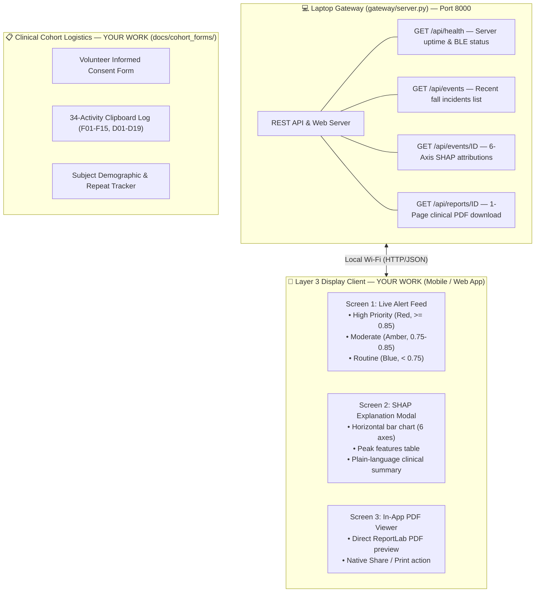

# SPARK — Sonia's Quick Start Guide

**For:** Sonia Thapa (79043 / BEI — Display Client & Validation Engineer)  
**Created:** October 20, 2026  
**Purpose:** One-stop onboarding document. Read this first to understand your dual ownership: (1) the Caregiver Display Client (Mobile / Web App), and (2) the Nepal Cohort Trial Protocols & Ethics Documentation.

---

## 1. What is SPARK & What is Your Mission?

**SPARK** (*Signal Pattern Analysis & Real-time Kinetics*) is an AI-powered fall detection system for the elderly. When a fall occurs, the wearable detects it, alerts the local gateway laptop, and generates an explainable clinical incident report.

**Your mission spans the two most human-facing parts of the project:**
1. **Track A (The Caregiver UI):** Build the clean, responsive mobile/web dashboard that nurses and family members look at on their phones to view live fall alerts, inspect 6-axis AI feature attributions (SHAP), and view/share the 1-page clinical incident PDF.
2. **Track B (Clinical Validation Logistics):** Prepare the institutional ethics consent forms and 34-activity tracking logs for our upcoming KEC volunteer data collection campaign on gym crash mats.



---

## 2. Crucial Architectural Rule: "Display-Only Client"

> [!IMPORTANT]
> **Do NOT write BLE scanning drivers or run neural networks on the mobile phone.**
> In SPARK, the laptop gateway handles all Bluetooth communication with the wearable, runs the heavy AI explainability engine (SHAP), and compiles the ReportLab PDF.
> **Your mobile/web app is strictly a display client** reading pre-computed JSON and PDF files from the laptop over local Wi-Fi (`http://<laptop-ip>:8000`). This ensures zero cloud dependencies and prevents mobile battery drain or background OS task killing.

---

## 3. The Team & Your Role

| Person | Role | What They Own |
| :-- | :-- | :-- |
| **Aaradhya Dev Tamrakar** | Project Lead | ML model training, gateway SHAP explainability, clinical PDF reports, overall architecture |
| **Rupesh Kadel** | Firmware Engineer | ESP32-S3 firmware, MPU6050 sensor driver, Layer 1 gate, TFLite Micro inference, BLE |
| **Sankalpa Lamsal** | Hardware/CAD | 3D-printed TPU wrist bracer enclosure, physical assembly |
| **Sonia Thapa (You)** | Display Client & Validation | **Layer 3 Caregiver UI (Flutter/React/PWA), REST API consumption, volunteer consent forms & trial logistics** |

---

## 4. Repository Map — Where Your Assets Live

```
SPARK/
├── gateway/                         ◄◄◄ YOUR PRIMARY CODE BASE ◄◄◄
│   ├── server.py                    ← Standalone REST API server with built-in replay simulator
│   ├── receiver/                    ← BLE & Replay receivers (already built)
│   ├── shap_pipeline/               ← Feature attribution engine (already built)
│   ├── report/                      ← PDF generation engine (already built)
│   └── storage/                     ← Local JSON event archive
│
├── docs/
│   ├── team_briefings/
│   │   └── SONIA_MOBILE_CLIENT_GUIDE.md ← Your detailed action checklist
│   ├── DATA_COLLECTION_PROTOCOL.md  ← Full 34-activity experimental matrix (READ THIS)
│   └── cohort_forms/                ◄◄◄ YOUR PROTOCOL FORMS DIRECTORY ◄◄◄
│       ├── VOLUNTEER_CONSENT_FORM.md    ← (To be scaffolded)
│       └── 34_ACTIVITY_CLIPBOARD_LOG.md ← (To be scaffolded)
└── tools/
    └── verify_cohort_dataset.py     ← Script to verify completed trial recordings
```

---

## 5. Getting Started — First Day Checklist

### Step 1: Run the Gateway Server in Replay Mode (Zero Hardware Needed)
The backend is already 100% complete with a built-in simulation engine. Run it right now:
```bash
# From SPARK repository root:
.venv\Scripts\python.exe gateway/server.py --port 8000
```
Open your browser to: **`http://localhost:8000`**  
You will see the embedded dark-mode dashboard with simulated fall events!

### Step 2: Test the REST API Endpoints
Open these URLs in your browser or Postman:
- `http://localhost:8000/api/health` $\to$ Returns receiver health and active fall count.
- `http://localhost:8000/api/events` $\to$ Returns JSON array of recent fall events.
- `http://localhost:8000/api/events/evt_replay_001` $\to$ Returns full event with SHAP attributions:
  ```json
  "shap": {
    "pitch_rate_wy": 0.34,
    "forward_accel_ax": 0.308,
    "vertical_accel_az": 0.18
  }
  ```
- `http://localhost:8000/api/reports/evt_replay_001` $\to$ Downloads the compiled one-page clinical PDF!

### Step 3: Test Local Network Access from Your Smartphone
1. Find your laptop's local IPv4 address (`ipconfig` on Windows, e.g., `192.168.1.75`).
2. Ensure phone and laptop are on the same Wi-Fi (or laptop mobile hotspot).
3. On your phone browser, open `http://192.168.1.75:8000`. If it loads, your mobile app can talk to the gateway!

### Step 4: Choose Your UI Framework & Scaffold App
You can build the Layer 3 client using **Flutter**, **React Native**, or a responsive **Web/PWA** (HTML5 + Tailwind/Chart.js).

---

## 6. Core UI Priority Badges Specification

To make fall confidence instantly readable for non-technical hospital staff, implement these priority thresholds:

| Priority Level | Confidence Range | Banner Color | Visual Cue & Action |
| :-- | :-- | :-- | :-- |
| **High Priority** | $P(\text{fall}) \ge 0.85$ | **Bright Red** | Urgent vibration/sound alert; immediate caregiver attention required |
| **Moderate Priority** | $0.75 \le P(\text{fall}) < 0.85$ | **Amber / Orange** | Warning banner; secondary check suggested |
| **Routine Check** | $P(\text{fall}) < 0.75$ | **Cool Blue / Grey** | Informational badge; logged for telemetry review |

---

## 7. Clinical Protocol Logistics Track (Track B)

Read [`docs/DATA_COLLECTION_PROTOCOL.md`](file:///f:/Aaradhya-Dev-Tamrakar/SPARK/docs/DATA_COLLECTION_PROTOCOL.md). You are responsible for:
1. **Volunteer Consent Form** (`docs/cohort_forms/VOLUNTEER_CONSENT_FORM.md`):
   - KEC Electronics Dept header.
   - Screening checklist (age 18–30 student volunteers, no recent musculoskeletal injury).
   - Gymnastic crash mat safety briefing acknowledgement.
2. **34-Activity Clipboard Log** (`docs/cohort_forms/34_ACTIVITY_CLIPBOARD_LOG.md`):
   - 15 Fall Trials: `F01`–`F15` (forward trips, backward slips, lateral falls, syncope collapses).
   - 19 ADL Trials: `D01`–`D19` (walking, jogging, sitting, jumping, ascending stairs).
   - Tracking Subject ID (`SA01`–`SA20`), trial repetitions (3 per fall, 3–5 per ADL), and file status.

---

## 8. GitHub Issue Assigned to You

- **[Issue #5: Gateway / UI: Local Dashboard & Mobile Display Client Interface](https://github.com/Aaradhya-Dev-Tamrakar/SPARK/issues/5)**
  - Assignee: `@Majorprj79043-Sonia`
  - Branch: `feat/layer3-display-client-#5`

---

## 9. Who to Coordinate With

- **Aaradhya (Project Lead):** Coordinate on REST API schema additions, SHAP field names, and supervisor ethics submission.
- **Rupesh (Firmware):** Coordinate during Phase 3 data collection on live sensor streaming rates and data logger CSV naming.
- **Sankalpa (Hardware):** Coordinate on wrist enclosure fit and strap comfort during participant trials.

---

> **Next step:** Open [`SONIA_MOBILE_CLIENT_GUIDE.md`](file:///f:/Aaradhya-Dev-Tamrakar/SPARK/docs/team_briefings/SONIA_MOBILE_CLIENT_GUIDE.md) and start working through the task checklist!
